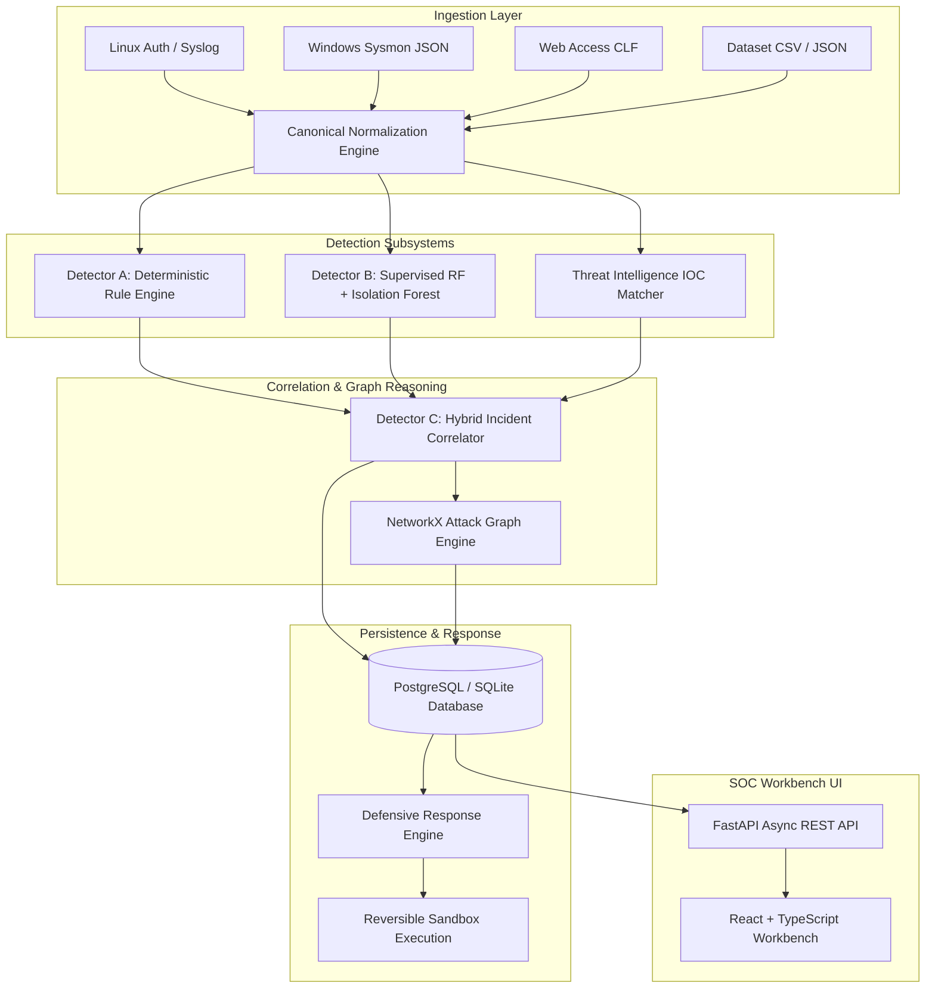

# Architecture Guide: SentinelX SOC Platform

## Executive Summary
SentinelX SOC is a hybrid security operations center platform built to bridge the gap between static rule-based alerting, statistical machine learning anomaly detection, and topological attack-graph reasoning.

---

## 1. System Architecture Diagram

---

## 2. Core Architectural Pillars

### A. Telemetry Ingestion & Canonical Event Normalization
- Converts disparate raw logs (Syslog RFC 3164/5424, Sysmon XML/JSON, Apache/Nginx CLF, CSV flows) into a strictly typed `CanonicalEvent`.
- Ensures deduplication, timestamp normalization to UTC, entity attribution (Host, User, Source IP, Destination IP, Process), and dead-letter queue isolation for corrupted records.

### B. Tri-Modal Threat Detection Engine
1. **Detector A (Deterministic Rules):**
   - High-precision patterns: repeated credential guessing (`RULE-001-SSH-BRUTEFORCE`), brute-force followed by accepted login (`RULE-002-SUSPICIOUS-AUTH-SUCCESS`), unauthorized sudo escalation (`RULE-005-PRIV-ESCALATION`), web directory traversal & SQL injection (`RULE-004-WEB-EXPLOIT-ATTEMPT`).
2. **Detector B (Machine Learning):**
   - Supervised Random Forest Classifier extracting 9 continuous & categorical telemetry vectors (port distributions, execution length, keyword densities, circadian timing).
   - Unsupervised Isolation Forest for novelty/anomaly score calibration with per-event inference latency profiling.
3. **Detector C (Hybrid Correlator & Attack-Graph Reasoning):**
   - Multi-entity graph model (NetworkX) linking identities, processes, IP entities, and detection findings.
   - PageRank centrality scoring and entity risk propagation.

### C. Controlled Defensive Response Engine
- Enforces strict human-in-the-loop RBAC for high-impact containment actions (Endpoint isolation, credential revocation).
- Provides deterministic dry-run simulation mode and immutable audit logs.
