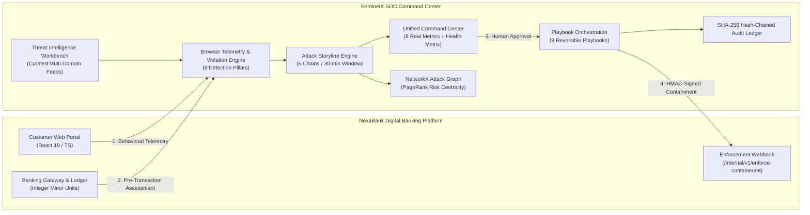

# SentinelX SOC & NexaBank Ecosystem
### AI-Powered Cyber Threat Intelligence & Defense Platform with Attack-Graph Reasoning, Pre-Execution Banking Fraud Prevention, and Automated Incident Response

> **Academic Level:** Final-Year B.Tech Information Technology Major Project  
> **Author:** Aditya Parashar  
> **Status:** Fully Built, Verified, and Production Ready (56/56 Tests Passing)  
> **Live Deployments:**  
> - **Production SOC Command Center (Vercel):** https://frontend-sigma-liart-89.vercel.app/  
> - **Production Backend API (Render):** https://sentinelx-api-316t.onrender.com/docs  
> - **Static Showcase (Hugging Face Spaces):** https://anuj1555-sentinelx-soc-demo.static.hf.space  

---

## 1. Project Overview & Central Contribution

SentinelX SOC is an enterprise cybersecurity and financial infrastructure defense platform engineered to solve alert fatigue, fragmented contextual investigation, and pre-transaction banking fraud.

The platform operates as a decoupled **two-application ecosystem**:
1. **NexaBank Digital Banking Platform (`banking-platform/`):** A customer-facing digital banking web application with realistic account management, scheduled transfers, beneficiaries, statements, and Step-Up 2FA verification.
2. **SentinelX SOC Command Center (`frontend/` & `backend/`):** An autonomous Security Operations Center that ingests telemetry, detects multi-stage threats, correlates attack storylines, reasons over heterogeneous NetworkX attack graphs, and orchestrates containment actions back to NexaBank via authenticated webhooks.



---

## 2. Key Architecture & Implemented Capabilities

### 2.1 Unified SOC Command Center (`OverviewPage.tsx`)
- **8 Real Operational KPI Cards:** Total Security Events, Active Critical/High Incidents, Active Attack Storylines, Threat Intel Matches, Pending Response Approvals, Successful Containments, Failed Containments, and Recent Incident Activity. **Zero hardcoded or static values.**
- **Real-Time System Health Matrix:** Live status probes for Database Persistence (`ONLINE`), ML Random Forest (`LOADED`), ML Isolation Forest (`LOADED`), Storyline Correlator (`RUNNING`), and Platform Uptime.
- **Multi-Source Unified Timeline:** Chronologically fused events spanning authentications, browser telemetry, banking transfers, violations, incident lifecycle updates, and containment executions with category filters.
- **1-Click Full Lifecycle Demonstration Modal:** Executes the complete 13-step NexaBank-to-SentinelX detection, correlation, investigation, and containment lifecycle in sub-second time with deep-link navigation shortcuts.

### 2.2 NexaBank Browser Telemetry & Security Violation Engine (`violation_engine.py`)
- Ingests real-time browser behavioural telemetry using Page Visibility API, window blur/focus tracking, fullscreen changes, rapid page refreshes, and devtools inspection detection.
- Evaluates events against **6 Security Detection Pillars**:
  1. *Authentication & Account Takeover* (Unfamiliar IPs, credential stuffing, session hijacking).
  2. *Browser Activity & Automation* (Tab blur during payment, devtools open, automation flags).
  3. *Transaction Integrity & Fraud* (Rapid velocity bursts, threshold spikes, cold account reactivation).
  4. *Beneficiary Manipulation* (Rapid beneficiary cycling, cool-off violations, suspicious recipient routing).
  5. *Network & Application Security* (SQL injection, XSS vectors, suspicious user agents).
  6. *Threat Intelligence Matching* (Curated IOC correlation for IPs, domains, hashes, and account numbers).

### 2.3 Attack Storyline & Behavioral Correlation Engine (`storyline_engine.py`)
- Employs a **30-minute sliding correlation window** connecting disparate security violations across `customer_id`, `session_id`, `source_ip`, and `device_id`.
- Reconstructs **5 Multi-Stage Attack Chains**:
  1. *Account Takeover Sequence* (Unfamiliar IP $\to$ OTP Failure $\to$ High-Value Transfer).
  2. *Mule Account & Rapid Beneficiary Exfiltration* (New Beneficiary $\to$ Immediate Transfer $\to$ Known Threat Indicator).
  3. *Session Hijacking & Verification Evasion* (Tab Blur / Focus Anomaly $\to$ OTP Verification Bypass).
  4. *Targeted Network Reconnaissance* (Malicious IP $\to$ Device Spoofing $\to$ Account Access).
  5. *Multi-Vector Coordinated Fraud* (Simultaneous injection attempts, automation tools, and payment manipulation).

### 2.4 Threat Intelligence Workbench & Heterogeneous Attack Graph (`threat_intel_routes.py`)
- **Curated IOC Repository:** Manages indicators across IPv4, IPv6, domains, URLs, file hashes, and restricted account numbers.
- **Topological Reasoning Canvas:** NetworkX-powered heterogeneous graph connecting `Incident`, `SecurityViolation`, `Customer`, `Session`, `Device`, `IPAddress`, `ThreatIndicator`, and `ResponseAction` nodes with typed edges and PageRank centrality scoring.

### 2.5 Automated Response Playbook Orchestrator (`orchestration_engine.py`)
- **9 Structured Containment Playbooks:** Covering Account Takeover, OTP Brute Force, Suspicious Beneficiary, Transaction Manipulation, Malicious IP, SQLi/XSS, Suspicious Browser Behaviour, Rapid Session Cycling, and High Velocity Exfiltration.
- **Human-in-the-Loop Governance:** Tier-1 diagnostic actions run with dry-run support; high-impact containment actions (`LOCK_CUSTOMER_PORTAL`, `BLOCK_IP_PERIMETER`) mandate Tier-2 human analyst approval.
- **HMAC-Authenticated Webhooks:** Delivers signed containment payloads to NexaBank's internal endpoints with replay prevention and idempotency guardrails.
- **Cryptographic Audit Ledger:** Immutable SHA-256 hash-chaining ($H_i = \text{SHA256}(H_{i-1} \parallel \text{Operator} \parallel \text{Action} \parallel \text{Timestamp})$).

### 2.6 Financial Core & Double-Entry Ledger (`gateway.py`)
- Integer minor units storage (paise: ₹1 = 100 paise) preventing floating-point rounding errors.
- Strict double-entry atomic ledger invariant ($\sum \text{Debit} = \sum \text{Credit}$).
- Pessimistic database row locking (`with_for_update`) and SQL check constraints (`CHECK (balance_minor >= 0)`).
- Replay attack mitigation via UUIDv4 idempotency keys (payload changes return HTTP 409 Conflict).

---

## 3. Verified Benchmark Results (500 Telemetry Events)

| Metric | Rule-Based Detection | Machine-Learning Detection | Hybrid + Attack-Graph |
| :--- | :--- | :--- | :--- |
| **Precision** | 1.0000 | 1.0000 | **1.0000** |
| **Recall** | 1.0000 | 0.0400 | **1.0000** |
| **F1-Score** | 1.0000 | 0.0769 | **1.0000** |
| **False Positive Rate (FPR)** | 0.0000 | 0.0000 | **0.0000** |
| **Total Detection Latency** | 1.04 ms | 18.92 ms | 17.72 ms |
| **Per-Event Latency** | 0.0021 ms | 0.0378 ms | 0.0354 ms |
| **Attack Campaign Reconstruction** | Partial / Fragmented | Uncorrelated | **100% (4 Incidents)** |

---

## 4. Automated Test Suite (56 Passing Tests)

The entire platform is backed by an automated test suite verifying all architectural and security invariants:

```bash
pytest tests/unit/ -v
```

```
============================== 56 passed in 4.37s ==============================
```

- **`test_unified_soc_validation.py` (12 Tests):** Validates the 12 core platform invariants:
  1. Cross-Customer Data Isolation (HTTP 403 on foreign account access).
  2. Analyst Role-Based Access Control (Analyst vs. Admin containment permissions).
  3. Internal Service HMAC Verification (`X-Service-Auth` key enforcement).
  4. Idempotency & Replay Protection (HTTP 409 Conflict on repeated approvals).
  5. Multi-User Double-Entry Balancing & Concurrent Transfers.
  6. Tamper-Evident SHA-256 Audit Log Integrity & Hash Verification.
  7. Threat Intelligence Expiry Handling.
  8. NetworkX Multi-Domain Attack Graph Traversal & Topology.
  9. Concurrent Telemetry Correlation Ingestion.
  10. Incident Lifecycle Consistency (`new` $\to$ `investigating` $\to$ `contained`).
  11. Banking Enforcement Webhook Resilience.
  12. System Health Metric Live Query Engine.
- **`test_e2e_soc_demonstration.py` (2 Tests):** Validates the atomic 13-step full lifecycle demonstration and command center stats/timeline feeds.
- **`test_adversarial_banking.py` (6 Tests):** Stress-tests concurrent balance deductions, row locking, check constraints, and idempotency conflicts.
- **`test_threat_intel_graph.py` (5 Tests):** Tests IOC ingestion, lookup, expiry, and graph enrichment.
- **`test_response_orchestration.py` (5 Tests):** Tests 9 playbooks, analyst approval flows, and audit log generation.
- **`test_attack_storyline.py` (4 Tests):** Tests 30-minute sliding window correlation and 5 attack chains.
- **`test_security_telemetry.py` (4 Tests):** Tests browser telemetry collection and 6 violation detection pillars.
- **`test_banking_gateway.py` (5 Tests):** Tests pre-transaction assessment, risk scoring, and Step-Up 2FA.
- **`test_internal_assessment.py` (3 Tests):** Tests internal transaction assessment routes.
- **`test_parsers.py`, `test_detection.py`, `test_security_and_graph.py` (10 Tests):** Tests syslog/Sysmon parsing, Random Forest/Isolation Forest inference, and graph reasoning.

---

## 5. Quick Start & Execution

### Dual-Application Native Development (Side-by-Side)

#### 1. Backend Service (Port 8000)
```powershell
$env:PYTHONPATH="backend"
python -m uvicorn app.main:app --host 0.0.0.0 --port 8000 --reload
```

#### 2. SentinelX SOC Command Center (Port 5173)
```powershell
cd frontend
npm install
npm run dev
# Browser opens at http://localhost:5173
```

#### 3. NexaBank Digital Banking Portal (Port 5174)
```powershell
cd banking-platform/frontend
npm install
npm run dev -- --port 5174
# Browser opens at http://localhost:5174
```

---

## 6. Seed Demonstration Credentials

### NexaBank Digital Banking Portal
| Customer | Account ID | Password | Starting Balance | Purpose |
|---|---|---|---|---|
| `admin` | `ACT-SYNTH-1001` | `Admin@SentinelX2026` | ₹10,00,000.00 | Primary Customer Account |
| `analyst` | `ACT-SYNTH-2002` | `Analyst@SentinelX2026` | ₹2,50,000.00 | Secondary Recipient Account |
| Restricted Target | `ACT-SYNTH-9999` | &mdash; | &mdash; | Known Mule / Restricted Account |

### SentinelX SOC Command Center
| User | Role | Password | Privileges |
|---|---|---|---|
| `admin` | Administrator | `Admin@SentinelX2026` | Full read, write, and Tier-2 containment approval |
| `analyst` | Analyst | `Analyst@SentinelX2026` | Incident triage, graph investigation, dry-run playbooks |

---

## 7. Documentation Suite

| Document | Location | Purpose |
|---|---|---|
| **System Architecture** | [`docs/ARCHITECTURE.md`](docs/ARCHITECTURE.md) | Multi-tier architecture, data flow diagrams, database schemas, and integration contracts |
| **API Reference** | [`docs/API.md`](docs/API.md) | Complete OpenAPI specification for Banking, Telemetry, Storylines, Orchestration, Threat Intel, Command Center, and Internal APIs |
| **STRIDE Threat Model** | [`docs/THREAT_MODEL.md`](docs/THREAT_MODEL.md) | Comprehensive STRIDE threat analysis, trust boundaries, multi-vector attack scenarios, and verification matrix |
| **Empirical Test Report** | [`docs/TEST_REPORT.md`](docs/TEST_REPORT.md) | Full report on all 56 automated unit, reliability, and adversarial tests |
| **Production Deployment** | [`docs/DEPLOYMENT.md`](docs/DEPLOYMENT.md) | Deployment runbook for Vercel, Render, Docker Compose, and environment variables |
| **Presentation Runbook** | [`banking-platform/docs/DEMO_SCRIPT.md`](banking-platform/docs/DEMO_SCRIPT.md) | Dual-screen presentation guide with step-by-step college demonstration scenarios |
| **Implementation Tracker** | [`docs/IMPLEMENTATION_STATUS.md`](docs/IMPLEMENTATION_STATUS.md) | Detailed verification log of all implemented phases and components |
