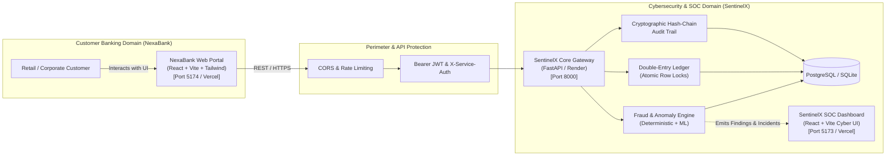

# NexaBank & SentinelX SOC Two-Application Ecosystem Architecture

This document describes the architectural separation, communication contracts, security controls, and deployment strategy connecting the customer-facing **NexaBank** digital banking platform and the **SentinelX SOC** threat defense engine.

---

## 1. High-Level System Architecture

---

## 2. Decoupling & Separation Principles

1. **Brand & Experience Separation:**
   - **NexaBank** is designed as a modern consumer fintech application (navy, emerald, white clean theme). Customers only see their accounts, beneficiaries, transfer forms, step-up OTP prompts, and transaction receipts.
   - Normal customers are **never** exposed to SentinelX SOC telemetry, threat scores, attack graphs, MITRE ATT&CK techniques, or analyst queues.
2. **Authoritative Backend Protection:**
   - The banking frontend does not evaluate fraud risk locally.
   - All state transitions (`CREATED` $\rightarrow$ `ASSESSING` $\rightarrow$ `AWAITING_VERIFICATION` / `HELD` $\rightarrow$ `POSTED` / `BLOCKED`) are executed server-side.
3. **Internal Assessment Contract (`/internal/v1/transaction-assessments`):**
   - External systems or third-party banking microservices can evaluate transactions directly via server-to-server authenticated assessment calls using `X-Service-Auth: <INTERNAL_SERVICE_KEY>`.
   - Returns sanitized customer-facing policy decisions (`ALLOW`, `VERIFY`, `HOLD`, `BLOCK`) while forwarding canonical security events directly into SentinelX SOC.

---

## 3. Financial Integrity & Invariants

| Invariant | Technical Implementation |
|---|---|
| **Minor Unit Precision** | All monetary amounts are handled strictly in integer minor units (paise/cents, where ₹1.00 = 100 paise). Floating point values are strictly forbidden in storage. |
| **Non-Negative Balances** | Enforced via database table check constraint `ck_bank_account_balance_positive` (`balance_minor >= 0`). |
| **Double-Entry Bookkeeping** | Each posted transfer generates exactly two paired rows: a `DEBIT` row on the source account and a `CREDIT` row on the destination account. $\sum DEBITS = \sum CREDITS$. |
| **Concurrency Protection** | Account balances are fetched with `with_for_update()` row-level locks during initiation and settlement to prevent double spending. |
| **Idempotency** | Every transfer submission requires an `idempotency_key`. Duplicated submissions with identical payloads return the original transfer. Submissions with altered payloads return `HTTP 409 Conflict`. |
| **Cryptographic Audit Chain** | State transitions are logged to `audit_logs` with SHA-256 hash chaining (`prev_hash | user_id | action | timestamp`). |

---

## 4. Policy Decision Matrix

| Policy Decision | Triggers | Customer Impact | SOC Event Impact |
|---|---|---|---|
| **`ALLOW`** | Amount $< ₹2,00,000$ & Trusted Beneficiary & Low Velocity | Immediate transfer completion & digital receipt. | Informational event logged in SOC stream. |
| **`VERIFY`** | Amount $\ge ₹2,00,000$ OR Elevated Velocity | Customer presented with 6-digit OTP modal. Funds held pending verification. | Medium-priority assessment event recorded. |
| **`HOLD`** | Amount $\ge ₹5,00,000$ OR Rapid Burst Velocity | Transfer placed under routine security review. Customer advised of review reference. | High-severity finding and incident created in analyst queue. |
| **`BLOCK`** | Restricted/Suspended Beneficiary (`ACT-SYNTH-9999`) OR Extreme Risk ($\ge 80/100$) | Transaction rejected immediately for security reasons. | Critical security incident created; alert dispatched to SOC analysts. |
