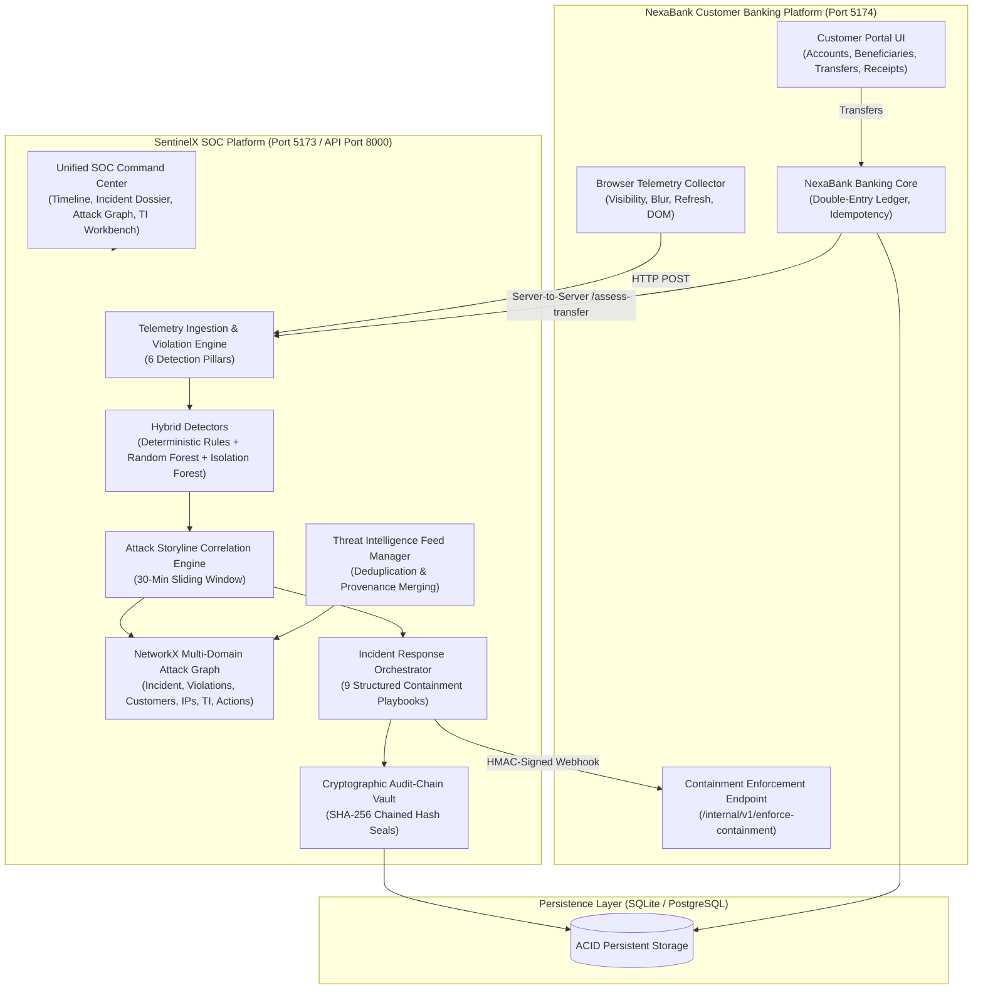

# SentinelX SOC & NexaBank Decoupled Ecosystem — Architecture Specification

## 1. Executive Summary

SentinelX SOC is an enterprise-grade autonomous security operations and cyber defense platform upgraded with:
1. An independent customer-facing digital banking platform (**NexaBank**).
2. A real-time **Security Telemetry & Behaviour Monitoring Collector**.
3. A 6-pillar **Security Violation Detection Engine**.
4. An **Attack Storyline & Behavioral Correlation Engine** (30-minute sliding window).
5. A **Unified Multi-Domain NetworkX Attack Graph Engine**.
6. A **Threat Intelligence Management & Investigation Workbench**.
7. An **Incident Response Playbook Orchestrator** (9 automated playbooks with Human-in-the-Loop Tier-2 approval).
8. A **Unified SOC Command Center** with a chronological multi-source investigation timeline.
9. **Tamper-Evident Audit Logging** using forward SHA-256 cryptographic hash-chaining.

---

## 2. Core Architectural Pillars

### 2.1 Decoupled Application Architecture
- **NexaBank (`banking-platform/`):** Standalone digital banking application with authentic retail banking UX (accounts, beneficiaries, statement history, transfers, step-up OTP challenge modals). Customers are completely shielded from internal SOC operational tools.
- **SentinelX SOC Core:** Autonomous backend providing pre-transaction fraud assessment, continuous behavioural analysis, multi-stage attack correlation, and containment orchestration.

### 2.2 Double-Entry Atomic Ledger Engine
- **Integer Minor Units:** All monetary values are strictly represented in minor units (paise: ₹1.00 = 100 paise) avoiding IEEE-754 floating-point rounding drift.
- **Atomic Balancing:** Every executed transfer generates exactly one `DEBIT` and one `CREDIT` ledger entry inside a database transaction lock (`with_for_update`).
- **Check Constraint:** Schema-level `CheckConstraint("balance_minor >= 0")` guarantees that account balances can never become negative under competing concurrent transfers.

### 2.3 Six Security Telemetry Detection Pillars
1. **Browser Behaviour Telemetry:** Tab switching bursts, window blur during OTP entry, rapid page refresh during transaction submission, copy-paste in sensitive fields.
2. **Authentication & Session Anomalies:** Unfamiliar device login, rapid session token reuse, failed OTP bursts.
3. **Transaction Fraud Detection:** Critical amount spikes exceeding historical thresholds, rapid succession velocity drains.
4. **Beneficiary Manipulation:** Rapid transfer to newly created beneficiaries, mutation of beneficiary account details immediately preceding payment.
5. **Network Anomalies:** Geolocation velocity drift, connections from known Tor exit nodes, C2 IPs, or blacklisted CIDR blocks.
6. **Web Application Security:** SQL injection probes in memo/reference inputs, cross-site scripting (XSS) script injections, client-side tampering.

### 2.4 Attack Storyline & Behavioral Correlation Engine
- **30-Minute Sliding Window:** Assembles disparate low-severity events into progressive attack chains:
  - Account Takeover (ATO) Chain
  - Beneficiary Mule Scheme
  - Social Engineering / DOM Interference
  - Targeted Network Intrusion
  - Application Exploit Attempt
- **Incident Deduplication:** Rather than inundating analysts with hundreds of isolated alerts, subsequent violation events belonging to the same customer/session/IP are attached directly to the active incident dossier, dynamically updating topological risk scores.

### 2.5 Incident Response Orchestration & Human-in-the-Loop
- **9 Structured Containment Playbooks:**
  1. `PLAYBOOK_ATO`: Session revocation, customer reauthentication, supervisory account watch.
  2. `PLAYBOOK_OTP_BRUTE_FORCE`: Challenge expiration, step-up biometric mandate, customer security SMS.
  3. `PLAYBOOK_BENEFICIARY_MULE`: Beneficiary account freeze, settlement rail suspension.
  4. `PLAYBOOK_TRANSACTION_FRAUD`: Pending transaction hold, source account debit block.
  5. `PLAYBOOK_MALICIOUS_IP`: Ingress IP gateway block, firewall drop rule.
  6. `PLAYBOOK_SQLI_XSS`: Offending session isolation, database query termination.
  7. `PLAYBOOK_SUSPICIOUS_BROWSER`: Immediate session termination, step-up challenge.
  8. `PLAYBOOK_API_ENUMERATION`: Rate-limiting, IP blacklist.
  9. `PLAYBOOK_CONCURRENT_ABUSE`: Transfer serialization, concurrent lock.
- **Tier-2 Human Approval:** High-impact containment actions require explicit approval by an authorized SOC analyst before dispatch.
- **Direct Enforcement:** Approved actions are dispatched via HMAC-authenticated webhooks to `/internal/v1/enforce-containment`.

### 2.6 NetworkX Multi-Domain Attack Graph
- **Unified Multi-Hop Canvas:** Models real relationships across 10 node types:
  `Incident`, `SecurityViolation`, `Customer`, `Session`, `IPAddress`, `Device`, `Transaction`, `BankAccount`, `ThreatIndicator`, and `ResponseAction`.
- **Topological Risk Scoring:** Computes risk weights based on node degree centrality and risk contributions.

### 2.7 Tamper-Evident Audit Logging
- Every analyst decision, status change, and containment action is recorded in `audit_logs`.
- Entries are sealed using SHA-256 cryptographic forward hash-chaining:
  $$\text{entry\_hash} = \text{SHA256}(\text{prev\_hash} \parallel \text{user\_id} \parallel \text{action} \parallel \text{resource\_type} \parallel \text{resource\_id} \parallel \text{timestamp})$$
