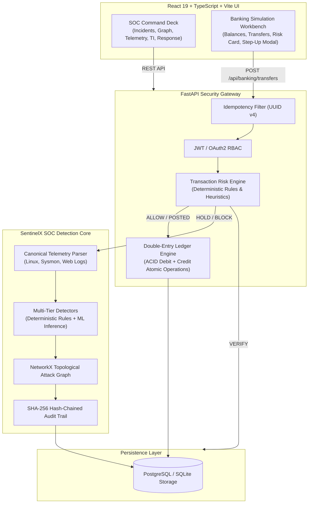

# SentinelX SOC & Banking Security Gateway — Architecture Specification

## 1. Executive Summary

SentinelX SOC is an enterprise-grade autonomous security operations and cyber defense platform upgraded with a deterministic pre-execution **Banking Security Gateway** and **Atomic Double-Entry Ledger**. 

The system unifies real-time host/network telemetry monitoring, machine-learning anomaly detection, topological attack-graph reasoning, automated response playbooks, and critical financial transaction risk prevention into a single defensible architecture.

---

## 2. Core Architectural Pillars

### 2.1 Double-Entry Atomic Ledger Engine
To eliminate floating-point inaccuracies and financial state discrepancies:
- **Integer Minor Units:** All monetary values are strictly represented and stored in minor units (e.g., paise: 100 paise = ₹1.00). No floating-point variables are used in balances or debit/credit arithmetic.
- **Double-Entry Principle:** Every approved transfer creates two complementary `LedgerEntry` records within a single database transaction:
  1. `DEBIT` entry against the `source_account_id` (`balance_after = balance_before - amount`).
  2. `CREDIT` entry against the `destination_account_id` (`balance_after = balance_before + amount`).
- **Zero Ledger Mutation in Non-Posted States:** Funds are never deducted or placed into escrow while a transfer is `AWAITING_VERIFICATION`, `HELD`, or `BLOCKED`. Balances mutate if and only if the transfer enters the `POSTED` state.

### 2.2 Formal Transfer State Machine

```mermaid
stateDiagram-v2
    [*] --> CREATED: User Initiates Transfer
    CREATED --> ASSESSING: Idempotency Checked
    ASSESSING --> POSTED: Risk Score < 40 (ALLOW)
    ASSESSING --> AWAITING_VERIFICATION: 40 <= Risk Score < 80 (VERIFY)
    ASSESSING --> HELD: Risk Score >= 80 (HOLD)
    ASSESSING --> BLOCKED: Critical Violation / Restricted Account (BLOCK)

    AWAITING_VERIFICATION --> POSTED: Valid OTP Verified (within 10m)
    AWAITING_VERIFICATION --> BLOCKED: Max Verification Attempts Exceeded / Expired

    POSTED --> [*]: Double-Entry Ledger Created
    HELD --> [*]: SOC Security Event Emitted
    BLOCKED --> [*]: Incident Auto-Generated
```

### 2.3 SentinelX SOC Event Integration
Suspicious transaction outcomes (`HOLD` and `BLOCK`) seamlessly cross boundaries from the banking gateway to the SOC detection core:
- A canonical `Event` is created with `source_name="banking-transaction-gateway"`, `source_type="BANKING_TX"`, and `severity="HIGH"` or `"CRITICAL"`.
- High-risk events generate actionable `Incident` records linked directly to the transfer ID, allowing SOC tier-1/tier-2 analysts to inspect the origin IP, account holder, risk score, and reason codes.
- Every state transition and response execution is logged to the tamper-evident `audit_logs` table using SHA-256 cryptographic hash-chaining (`hash = SHA256(prev_hash + record_data)`).

---

## 3. Module Decomposition

| Module | Location | Responsibility |
|---|---|---|
| **Banking Gateway** | `backend/app/banking/gateway.py` | Idempotency validation, transfer lifecycle orchestration, double-entry ledger mutation, and challenge management. |
| **Risk Engine** | `backend/app/banking/risk_engine.py` | Pre-transaction deterministic rule evaluation, velocity window calculation, and policy decision mapping. |
| **Banking Routes** | `backend/app/banking/routes.py` | REST endpoints for accounts, transfers, step-up challenges, and ledger histories. |
| **Detection Core** | `backend/app/detection/` | Rule-based brute force detectors, Random Forest, Isolation Forest, and hybrid correlation. |
| **Graph Engine** | `backend/app/graph/attack_graph.py` | Multi-hop directed entity traversal connecting hosts, accounts, processes, and network egress points. |
| **Response Engine** | `backend/app/response/engine.py` | Defensive playbooks (account freeze, IP block, credential revoke) with guardrail allowlisting and dry-run execution. |
| **Frontend UI** | `frontend/src/` | Command Deck, Incident Triage, Topological Graph, Detection Lab, Threat Intel, and Banking Workbench. |
