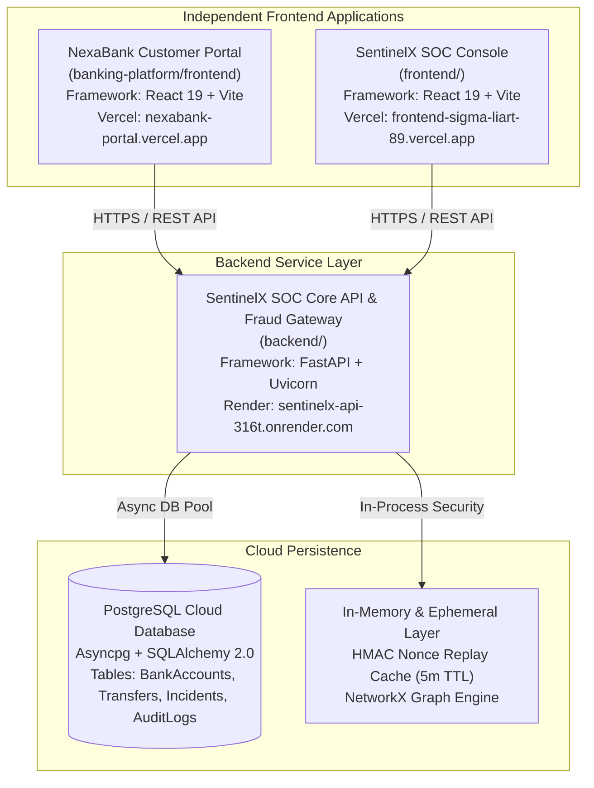

# SentinelX SOC & NexaBank — Production Deployment Architecture & Runbook

**Document Revision:** 2.2.0  
**Target Release Date:** November 2026  
**Repository:** `https://github.com/ROBUST-Anuj/sentinelx-soc`  
**Target Branch:** `main`  

---

## 1. System Architecture Overview

The production architecture consists of two decoupled frontends, one shared microservices backend, and managed cloud persistence:



### 1.1 Separation Invariant
- **NexaBank (`banking-platform/frontend`)**: Dedicated customer-facing digital banking interface. Provides account management, internal bank transfers, step-up OTP challenge handling, and real-time security telemetry emission. Customers never access SOC telemetry or threat graphs.
- **SentinelX SOC (`frontend`)**: Independent cybersecurity operations workbench for SOC analysts and incident responders. Provides live threat intelligence feeds, attack storyline correlation, NetworkX bipartite graphs, and human-in-the-loop containment playbooks.
- **SentinelX Core API (`backend`)**: Unified Python FastAPI backend providing pre-transaction fraud scoring, HMAC server-to-server signing verification, role-based access control (RBAC), and hash-chained audit logging.

---

## 2. Environment Configurations & Secrets

| Parameter | Service | Production Value / Description | Sensitive |
|---|---|---|:---:|
| `PORT` | Backend | `10000` | No |
| `ENVIRONMENT` | Backend | `production` | No |
| `DATABASE_URL` | Backend | `postgresql+asyncpg://<user>:<password>@<host>/<database>` | **Yes** |
| `SECRET_KEY` | Backend | 64-character cryptographic random hex key | **Yes** |
| `INTERNAL_SERVICE_KEY` | Backend | 64-character inter-service HMAC shared secret | **Yes** |
| `CORS_ORIGINS` | Backend | `["https://frontend-sigma-liart-89.vercel.app", "https://nexabank-portal.vercel.app", "https://nexabank-frontend.vercel.app"]` | No |
| `CORS_ORIGIN_REGEX` | Backend | `None` (Wildcard regexes strictly removed) | No |
| `VITE_API_BASE_URL` | NexaBank & SOC | `https://sentinelx-api-316t.onrender.com` | No |

---

## 3. NexaBank Vercel Deployment Guide

To deploy the NexaBank customer portal as an independent Vercel project:

### Option A: Vercel Web Dashboard (Recommended)
1. Navigate to [Vercel Dashboard](https://vercel.com/dashboard).
2. Click **Add New...** -> **Project**.
3. Import the existing GitHub repository: `ROBUST-Anuj/sentinelx-soc`.
4. Configure Project Settings:
   - **Project Name:** `nexabank-portal`
   - **Framework Preset:** `Vite`
   - **Root Directory:** Click *Edit* and select `banking-platform/frontend`.
5. Environment Variables:
   - Add `VITE_API_BASE_URL` with value `https://sentinelx-api-316t.onrender.com`.
6. Click **Deploy**.
7. Ensure SPA routing is supported via the included `vercel.json` rewrite:
   ```json
   {
     "rewrites": [
       { "source": "/(.*)", "destination": "/index.html" }
     ]
   }
   ```

### Option B: Vercel CLI
```bash
# From workspace root
npx vercel --cwd banking-platform/frontend --prod
```

---

## 4. Render Backend Deployment & Schema Evolution

1. **Service Type:** Web Service (Docker / Python 3.13)
2. **Build Command:** `pip install -r requirements.txt`
3. **Start Command:** `uvicorn app.main:app --host 0.0.0.0 --port $PORT`
4. **Health Check Path:** `/health`
5. **Database Migration Strategy:**
   - Database migrations run during lifespan initialization in `backend/app/main.py`.
   - All migrations are tracked idempotently in the `schema_migrations` table.
   - All `ALTER TABLE` statements use `ADD COLUMN IF NOT EXISTS` and default values, ensuring existing customer records and transaction ledgers are non-destructively preserved.

---

## 5. Rollback & Disaster Recovery Procedures

1. **Frontend Rollback:**
   - In the Vercel dashboard for either project, navigate to **Deployments**.
   - Select the previous stable deployment and click **Rollback to this Deployment**.
2. **Backend Rollback:**
   - In the Render dashboard, select **Deploys**.
   - Revert to the prior deployment commit (`64b0a1c`).
3. **Database Integrity:**
   - Automated schema migrations only add nullable columns with defaults. Never roll back database tables with `DROP COLUMN` or `DROP TABLE`.
