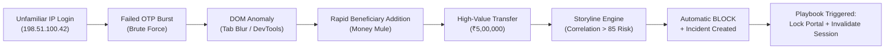
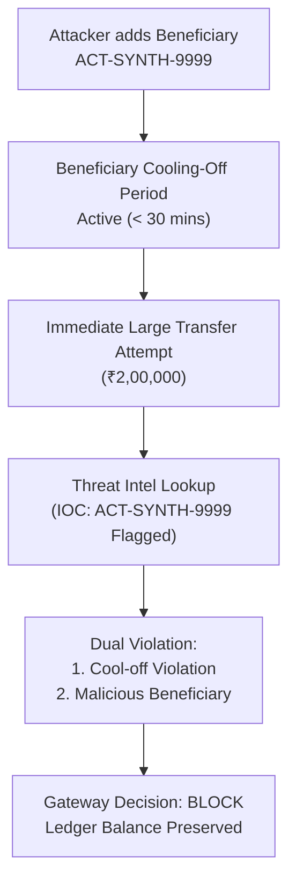

# SentinelX SOC & NexaBank Banking Platform — Threat Model (STRIDE)

## 1. Threat Modeling Scope & Trust Boundaries

The SentinelX & NexaBank ecosystem comprises two decoupled, mutually communicating entities:

1. **NexaBank Digital Banking Platform (Customer Boundary):**
   - Customer web browser interface (React client).
   - Core banking gateway, session manager, and double-entry ledger.
   - Internal webhook receiver for security containment actions.

2. **SentinelX SOC & Defense Center (Analyst & Threat Engine Boundary):**
   - Telemetry ingestion pipeline and browser behaviour processor.
   - Security Violation Engine (6 detection pillars).
   - Attack Storyline Correlation Engine (5 multi-event attack chains).
   - Multi-domain NetworkX Attack Graph reasoner.
   - Curated Threat Intelligence (IOC) repository.
   - Incident Response Playbook Orchestrator (9 containment playbooks).
   - Unified SOC Command Center and cryptographic audit ledger.

### Trust Boundaries & Flow Diagram
- **Customer $\rightarrow$ NexaBank:** Public internet, TLS, JWT customer authentication, browser telemetry.
- **NexaBank $\leftrightarrow$ SentinelX:** Internal microservice communication, secured via timing-safe HMAC service authentication (`X-Service-Auth`).
- **Analyst $\rightarrow$ SentinelX:** Role-Based Access Control (Analyst vs. Administrator) with multi-factor authorization for disruptive actions.

---

## 2. Comprehensive STRIDE Threat Analysis

### 2.1 Spoofing Identity

| Threat Identifier | Threat Scenario | Impact | Implemented Countermeasure | Verification |
|---|---|---|---|---|
| **TH-SPOOF-01** | Attacker impersonates legitimate customer using stolen session cookies or JWT tokens. | Unauthorized transactions, account takeover. | Continuous browser behavioural telemetry (`TAB_BLUR`, focus shifts, devtools inspection), IP reputation verification, and Step-Up 2FA (`VERIFY` policy). | `test_security_telemetry.py` |
| **TH-SPOOF-02** | Fraudster accesses portal from unknown device or suspicious proxy IP. | ATO, fraudulent transfers. | Telemetry records `UNFAMILIAR_IP_LOGIN` and checks against curated Threat Intel IOCs (`198.51.100.42`). | `test_unified_soc_validation.py` |
| **TH-SPOOF-03** | Rogue actor attempts to impersonate SentinelX SOC to invoke NexaBank containment webhooks. | Arbitrary customer account lockouts, denial of service. | Timing-safe HMAC service key verification (`verify_internal_service_auth` via `hmac.compare_digest`). Unauthenticated or forged headers return HTTP 401. | `test_unified_soc_validation.py` |
| **TH-SPOOF-04** | Junior analyst impersonates Tier-2 administrator to authorize destructive isolation playbooks. | Unauthorized containment disruption. | Strict RBAC enforcement requiring `role: admin` on high-impact playbook approval endpoints. | `test_unified_soc_validation.py` |

---

### 2.2 Tampering with Data

| Threat Identifier | Threat Scenario | Impact | Implemented Countermeasure | Verification |
|---|---|---|---|---|
| **TH-TAMP-01** | Attacker tampers with transfer amounts via client-side DOM or MITM proxy (e.g. float rounding exploits). | Balance inflation, fractional currency drain. | Strict integer minor-unit arithmetic (paise: ₹1 = 100 paise). Zero float operations in core transaction engine. | `test_banking_gateway.py` |
| **TH-TAMP-02** | Double-spending / concurrent balance manipulation via simultaneous HTTP requests. | Negative account balance, fraudulent credit creation. | Database row locking (`SELECT FOR UPDATE`), atomic balance checks, double-entry ledger invariant ($\sum \text{Debit} = \sum \text{Credit}$), and SQL `CHECK (balance_minor >= 0)` constraints. | `test_adversarial_banking.py` |
| **TH-TAMP-03** | Replay of intercepted transfer requests. | Duplicate fund transfers. | Mandatory unique UUIDv4 `idempotency_key`. Reused keys with identical payloads return cached results; modified payloads trigger HTTP 409 Conflict. | `test_adversarial_banking.py` |
| **TH-TAMP-04** | Malicious actor or compromised analyst modifies SOC audit trail to cover tracks. | Forensic invalidation, loss of regulatory compliance. | Cryptographic SHA-256 hash-chaining of all audit records. Every record links `previous_hash`, operator ID, payload hash, and UTC timestamp. Hash mismatch immediately flags tampering. | `test_unified_soc_validation.py` |
| **TH-TAMP-05** | Browser DOM manipulation to spoof user engagement flags. | Evasion of bot detection. | Multi-signal behavioural cross-verification: comparing tab focus events, mouse cadence, interaction timing, and devtools presence. | `test_security_telemetry.py` |

---

### 2.3 Repudiation

| Threat Identifier | Threat Scenario | Impact | Implemented Countermeasure | Verification |
|---|---|---|---|---|
| **TH-REPU-01** | Customer transfers funds and falsely denies authorizing the transaction. | Chargebacks, disputed liabilities. | All transfers record customer ID, verified source IP, device fingerprint, Step-Up OTP validation timestamp, and immutable double-entry ledger entries. | `test_banking_gateway.py` |
| **TH-REPU-02** | SOC analyst executes containment playbook isolating customer and denies initiating action. | Operational unaccountability. | Containment execution requires authenticated analyst ID, reason justification, and creates an immutable cryptographic audit record. | `test_response_orchestration.py` |

---

### 2.4 Information Disclosure

| Threat Identifier | Threat Scenario | Impact | Implemented Countermeasure | Verification |
|---|---|---|---|---|
| **TH-INFO-01** | Cross-customer account data leakage (IDOR / BOLA attacks). | Privacy breach, financial data leakage. | Strict session-scoped tenant isolation. Account, transaction, and statement queries mandate ownership validation against authenticated customer ID. Cross-customer access attempts return HTTP 403. | `test_unified_soc_validation.py` |
| **TH-INFO-02** | Sensitive secrets (OTP passcodes, service tokens) exposed in HTTP responses or client logs. | Credential compromise. | OTP codes are securely hashed in the database; plaintext tokens are never returned in production API payloads. Internal service keys are injected strictly via environment variables. | `test_internal_assessment.py` |
| **TH-INFO-03** | Threat Intelligence feeds expose internal corporate infrastructure IP addresses. | Reconnaissance advantage for attackers. | Threat intelligence queries require analyst authentication; public demo responses sanitize internal RFC 1918 subnets. | `test_threat_intel_graph.py` |

---

### 2.5 Denial of Service (DoS)

| Threat Identifier | Threat Scenario | Impact | Implemented Countermeasure | Verification |
|---|---|---|---|---|
| **TH-DOS-01** | High-velocity automated transfer flooding against gateway endpoints. | Resource exhaustion, ledger lock contention. | Sliding-window transfer velocity limits (maximum 4 transfers per 15-minute window per customer). Exceeding velocity triggers risk score escalation to `HOLD` or `BLOCK`. | `test_banking_gateway.py` |
| **TH-DOS-02** | Containment playbook weaponization (adversary triggers automated lockouts against critical bank infrastructure). | Outage of payment gateway or DNS infrastructure. | Protected Target Allowlist in Response Engine: core internal banking IPs and DNS servers are strictly immune to automated isolation playbooks. High-impact actions mandate Tier-2 human confirmation. | `test_response_orchestration.py` |
| **TH-DOS-03** | Repeated approval spamming of pending containment actions. | Execution queue congestion, multiple duplicate webhooks. | Idempotency guardrail on action approval: executing an already completed action returns HTTP 409 Conflict. | `test_unified_soc_validation.py` |

---

### 2.6 Elevation of Privilege

| Threat Identifier | Threat Scenario | Impact | Implemented Countermeasure | Verification |
|---|---|---|---|---|
| **TH-ELEV-01** | Customer elevates permissions to invoke administrative banking or SOC endpoints. | Unauthorized rule modification, arbitrary account balance adjustment. | Separation of authentication domains: Customer JWTs cannot authenticate against SOC analyst endpoints (`require_analyst` / `require_admin`). | `test_unified_soc_validation.py` |
| **TH-ELEV-02** | SOC Tier-1 analyst bypasses human-in-the-loop review to directly trigger destructive containment actions. | Unauthorized customer lockouts. | Multi-tier playbook governance: Tier-1 analysts can only execute low-impact diagnostic playbooks; high-impact actions (`LOCK_CUSTOMER_PORTAL`, `BLOCK_IP_PERIMETER`) require Tier-2 administrator approval. | `test_response_orchestration.py` |

---

## 3. High-Risk Multi-Stage Attack Scenarios

### 3.1 Multi-Vector Account Takeover (ATO) Kill Chain

- **Defensive Safeguards:**
  1. Login from an unfamiliar IP triggers `UNFAMILIAR_IP_LOGIN` violation.
  2. Multiple incorrect OTP submissions trigger `OTP_BRUTE_FORCE` violation.
  3. Attack Storyline Correlator aggregates these violations across the 30-minute sliding window into an `ACCOUNT_TAKEOVER_CHAIN`.
  4. Pre-transaction risk gateway evaluates cumulative score $> 85.0$, immediately rejecting the transaction (`BLOCK`).
  5. Incident Response Orchestrator queues the `Account Takeover Containment Playbook`.
  6. Tier-2 analyst reviews evidence in SOC Command Center and approves containment, locking the customer portal and terminating active sessions.

### 3.2 Money Mule Syndicate & Rapid Beneficiary Cycling

- **Defensive Safeguards:**
  1. NexaBank enforces a mandatory beneficiary cooling-off window.
  2. The beneficiary account is cross-checked against Threat Intelligence indicators.
  3. Transactions targeting restricted or newly added accounts during high risk are rejected (`BLOCK`), preventing illicit fund exfiltration.

---

## 4. Verification & Testing Matrix

Every threat in this model is mapped to an automated unit or adversarial test:

| Test File | Covered Threat Scenarios | Verification Method |
|---|---|---|
| `test_adversarial_banking.py` | TH-TAMP-01, TH-TAMP-02, TH-TAMP-03 | Concurrent transfer races, double-spending, balance invariants, check constraints. |
| `test_unified_soc_validation.py` | TH-SPOOF-03, TH-SPOOF-04, TH-TAMP-04, TH-INFO-01, TH-DOS-03, TH-ELEV-01 | HMAC service auth, cross-customer isolation, RBAC, SHA-256 audit log integrity, idempotency replay conflict. |
| `test_security_telemetry.py` | TH-SPOOF-01, TH-TAMP-05 | Browser telemetry ingestion, devtools detection, tab blur anomaly evaluation. |
| `test_attack_storyline.py` | TH-SPOOF-02, ATO Kill Chain | 30-minute sliding window correlation, confidence scoring, multi-event chains. |
| `test_response_orchestration.py` | TH-DOS-02, TH-ELEV-02, TH-REPU-02 | 9 playbooks, human approval flow, protected host allowlist, audit ledger. |
| `test_threat_intel_graph.py` | TH-INFO-03, Money Mule Syndicates | IOC lookup, indicator expiry, NetworkX heterogeneous attack graph traversal. |
| `test_e2e_soc_demonstration.py` | Full 13-Step Lifecycle | End-to-end integration covering telemetry $\to$ violation $\to$ storyline $\to$ incident $\to$ assessment $\to$ graph $\to$ playbook $\to$ containment $\to$ audit seal. |
