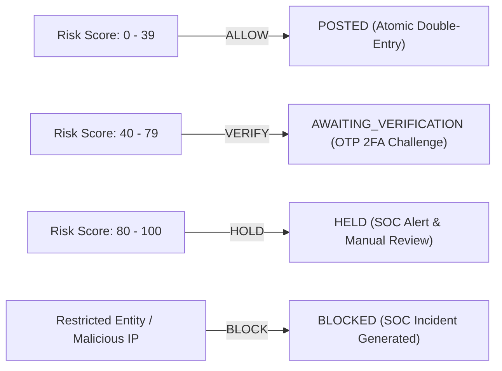

# SentinelX Pre-Transaction Risk & Fraud Policy Engine

## 1. Engine Overview

The `FraudDetectionEngine` evaluates financial transaction requests synchronously **before** funds are touched or ledger entries are recorded. 

It synthesizes:
1. Static financial thresholds (High value, critical value)
2. Behavioral velocity metrics (Burst attempts, rolling-window limits)
3. Destination entity status (Active vs. Restricted/Frozen)
4. Telemetry and threat intelligence correlation (Malicious client IP matching active IOCs)

---

## 2. Risk Rules & Weights

| Rule Identifier | Trigger Condition | Weight / Penalty | Policy Influence |
|---|---|:---:|:---:|
| `DESTINATION_ACCOUNT_RESTRICTED` | Target account status is `frozen` or `closed` | +100 | Immediate `BLOCK` |
| `CRITICAL_AMOUNT_THRESHOLD` | Amount > ₹5,00,000.00 (500,000,00 paise) | +85 | Immediate `HOLD` |
| `HIGH_AMOUNT_THRESHOLD` | Amount > ₹2,00,000.00 (200,000,00 paise) | +45 | Triggers `VERIFY` |
| `RAPID_BURST_WINDOW` | $\ge 2$ transfers within 60 seconds from same source | +35 | Promotes to `VERIFY`/`HOLD` |
| `VELOCITY_THRESHOLD_EXCEEDED` | $> 4$ transfers in 15-minute sliding window | +40 | Promotes to `HOLD` |
| `THREAT_INTEL_IP_MATCH` | Request client IP exists in active SOC IOC database | +90 | Immediate `BLOCK` |
| `NEW_ACCOUNT_DRAIN` | Account created $< 24$ hours ago attempting $> 80\%$ drain | +50 | Triggers `VERIFY` / `HOLD` |

---

## 3. Policy Decision Mapping

The aggregate risk score is calculated as the sum of all triggered rule penalties, clamped between $0$ and $100$:

$$\text{RiskScore} = \min\left(100, \sum_{r \in \text{TriggeredRules}} \text{Weight}_r\right)$$

### Decision Thresholds

1. **`ALLOW` (Score $0 - 39$):**
   - Normal low-risk transfer.
   - Immediately executes atomic double-entry ledger mutation and transitions to `POSTED`.
2. **`VERIFY` (Score $40 - 79$):**
   - Elevated risk requiring step-up authentication.
   - Creates a 10-minute expiring `VerificationChallenge` record.
   - Status remains `AWAITING_VERIFICATION`. Balance is untouched.
3. **`HOLD` (Score $80 - 100$):**
   - High-risk transaction.
   - Status set to `HELD`. Balance is untouched.
   - Emits a high-severity `BANKING_FRAUD_HOLD` event into the SOC pipeline.
4. **`BLOCK` (Critical Invariant Violation):**
   - Prohibited transaction (e.g. frozen account or confirmed threat actor IP).
   - Status set to `BLOCKED`. Transfer aborted.
   - Automatically provisions a critical `Incident` in SentinelX SOC with assigned triage workflow.
